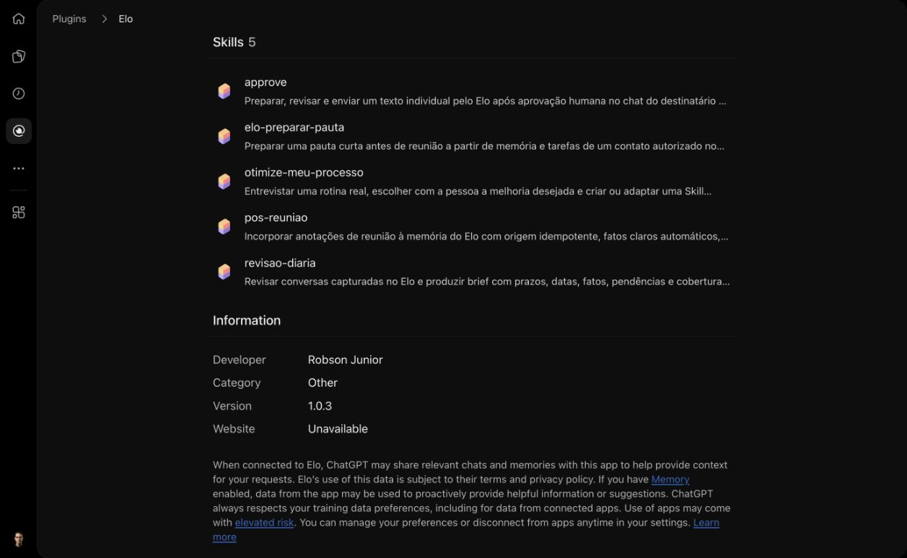

# Homologação do consultor fictício no ChatGPT

Data: **17/10/2026**. Ambiente: [Elo publicado](https://elo.robsonlins.workers.dev), versão final Worker `16fe1435-291e-428b-aab3-8feb98d3023b`, código `5f5103d`. A conexão inicial usou `a5d9a0d`; o ensaio revelou um defeito e a correção exigiu atualização do servidor e da Skill pós-reunião.

O plugin privado [Elo](https://chatgpt.com/plugins/plugin_asdk_app_6ad36d6a59f881919b3de4f512858abf) foi conectado à conta pessoal por DCR/OAuth, com Cloudflare Access OTP e consentimento para ChatGPT. O plano comercial não foi identificado; a prova vale para a conta usada, não para todos os planos. O envio real anterior foi realizado por cliente HTTP MCP próprio, não por escrita direta no banco e não pela interface do ChatGPT.

## O que passou no ambiente publicado

| Cenário | Prova e limite |
|---|---|
| Login e descoberta | Consentimento real, callback ao ChatGPT, diagnóstico da versão publicada e 23 ferramentas disponíveis |
| Quatro homônimos | Quatro contatos fictícios `SIM-ELO-1710 Mario`, com IDs distintos; paginação de uma linha até o fim |
| Atualização de ficha | Alias, relacionamento e cadência alterados somente no contato escolhido |
| Pós-reunião por operações MCP | Mesma chave importada repetidamente retornou o mesmo `source_id`; fonte e memória consultadas pelo ChatGPT |
| Memória paginada | Fatos claros confirmados; candidato incerto pendente; todas as páginas percorridas |
| Conflito e confirmação | Novo objetivo pendente, confirmação explícita e anterior preservado como `superseded` |
| Correção e descarte | Correção com registro anterior preservado; descarte mantido no histórico |
| Tarefa | Repetição idêntica retornou o mesmo ID; conclusão, reabertura e ajuste de prazo conferidos |
| Replay após revisão | Nova escrita idêntica preservou a tarefa aberta e o prazo revisado, sem voltar à data original |
| Datas e interação | 29/02 sem política recusado; `feb28` aceito; reunião e contato relevante separados |
| Atenção | Tarefa futura não apareceu como vencida no dia civil consultado, com fuso explícito |
| Projeção/identidade | Fonte de outro contato e alias com identificador restrito recusados; contato sem WhatsApp não pôde preparar envio |
| Retenção | Fonte fictícia de 31 dias retornou indisponível; gravação de memória usando essa fonte foi recusada |
| Cancelamento | Rascunho preparado, consultado, cancelado e consultado novamente; não houve execução |
| Exclusão | Somente um contato fictício criado pelo ensaio foi excluído; consulta posterior foi recusada e os demais permaneceram |
| Revisão/associação inválidas | Cursor sem revisão, conclusão com token inexistente e associação sem remetente válido recusados |
| Recebimento autorizado | Evento real adicional chegou e foi consultado pelo conector instalado; latência observada de 697 ms entre evento e persistência. Conteúdo e identificadores reais não são publicados |
| Saúde e fronteira pública | Seis smokes passaram: home, D1/saúde, MCP sem autenticação, bearer inválido, webhook protegido e descoberta OAuth/PKCE |

As operações de memória/tarefas foram exercitadas no ChatGPT web com **GPT-5.6 Sol Medium**. Leituras independentes pelo conector instalado e consultas delimitadas ao D1 conferiram os registros sintéticos. Assertivas, referências da versão e hashes das Skills estão em [homologacao-chatgpt.json](homologacao-chatgpt.json). Nenhum número, JID/LID, token ou texto de conversa real entra nesse artefato.

## Instalação das quatro Skills

O mesmo plugin Elo contém as quatro Skills de base: `approve`, `revisao-diaria`, `pos-reuniao` e `otimize-meu-processo`. Na conta pessoal, foi acrescentada a rotina fictícia gerada no ensaio, [elo-preparar-pauta](../exemplos/elo-preparar-pauta/SKILL.md), para testar a instalação da saída de “Otimize meu processo”. Foi preservado o vínculo ao App existente, sem novo cadastro MCP ou alteração de OAuth. A versão final **1.0.3**, release `pluginrel_6ad37fcb97008191a5151e8ae7dcae13`, é privada e pessoal. O vínculo MCP e a apresentação foram preservados.

A primeira publicação das Skills tinha os arquivos, mas não declarava `skills` no manifesto de compatibilidade. Foi corrigida com `skills: "./skills/"`, conforme o [formato documentado pela OpenAI](https://developers.openai.com/plugins/build/plugins). A leitura posterior do release confirmou a declaração, o mesmo `.app.json`, os demais metadados preservados e os quatro arquivos originais **byte a byte iguais** aos fontes do repositório; a verificação foi repetida nos cinco arquivos do release 1.0.3, incluindo o exemplo. Publicar os arquivos e vê-los na página do plugin não basta para alegar seleção/execução: essas provas são registradas separadamente.

## Ensaio das Skills no Work

No ChatGPT Work, com **GPT-6.1 Sol High**, foram carregados os arquivos instalados de `pos-reuniao`, `revisao-diaria` e `otimize-meu-processo` da versão 1.0.2. O contato fictício usado estava sem memória ou tarefas antes do ensaio.

A pós-reunião gravou três memórias: preferência por reuniões à tarde e objetivo de aprender violão confirmados; possível mudança de cidade pendente. A tarefa de enviar pauta até 23/10/2026 foi atribuída ao consultor, e a reunião de 17/10 às 10h ficou separada de contato relevante. A repetição imediata retornou os mesmos IDs. Uma leitura independente posterior, após o cron, encontrou **duas tarefas equivalentes com redações diferentes**. Assim, a repetição imediata sozinha não era prova suficiente de idempotência do fluxo completo.

A revisão diária percorreu o contato autorizado e declarou cobertura **incompleta**: `review_page` não possui filtro por contato, então não foi chamada para evitar ampliar o acesso a conversas reais. Não houve marcação fictícia de revisão concluída.

“Otimize meu processo” produziu e testou uma rotina de pauta usando somente o snapshot fictício. Ela sugeriu perguntas sobre finalidade, próximo encontro, objetivo e incerteza, com referências. O arquivo foi salvo no Work; naquela primeira execução o pacote não estava instalado (`skill package is not available`). Depois o mesmo arquivo foi incluído no plugin 1.0.3 e efetivamente carregado/executado no ensaio seguinte. A validação humana e qualquer redução real de tempo/dúvidas continuam pendentes. Os 40 minutos eram uma referência hipotética, não uma medição.

## Achados e limites

- GPT-6 nesta sessão falhou com “This response couldn’t load” até no pedido “responda OK” sem ferramentas. GPT-5.6 Sol respondeu e usou o Elo. Isso não é um teste de indisponibilidade do MCP nem prova sobre todas as versões do GPT-6.
- Consultas paralelas pelo conector instalado tiveram erros internos transitórios; leituras sequenciais repetidas funcionaram. A causa não foi determinada. Escritas/envios não foram repetidos cegamente.
- Comparação de memória ainda é conservadora: “Aprender italiano” e “Objetivo de aprender italiano” geraram candidatos distintos e uma pendência. Também pode haver tarefas semelhantes produzidas pela extração e por uma escrita manual com outra redação. O ensaio deliberadamente testou operações individuais; isso não comprova deduplicação semântica universal nem deduplicação de origens distintas ou de reimportação após mudar o ID do contato por associação.
- Uma anotação inicial de teste misturava falas em primeira pessoa. A tarefa automática foi atribuída ao contato, enquanto a chamada manual especificava consultor. Isso limita a avaliação de autoria desse caso; o ensaio das Skills usa papéis explícitos.
- O diagnóstico retorna o último código de erro registrado, que pode ser histórico, e distingue configuração de conexão de verificação atual do provedor. O código antigo `whatsapp_nao_configurado` não contradiz o recebimento/envio posteriores comprovados.

## O que não está declarado como testado por esta bateria

Revisão diária integral com fontes reais, associação positiva de remetente em produção, renovação Access isolada especificamente neste cliente, revogação por remoção do plugin, execução agendada do Work/Cowork, Claude, celular físico e piloto leigo. Os casos de concorrência, edição, replay, expiração, restauração, isolamento, associação, exclusão e timeout têm testes controlados próprios; isso não substitui prova real por plataforma.

`npm run test:all` passou no código final: **134 testes D1/workerd + 22 testes Node**, com provedores controlados. TypeScript e build passaram. Houve revisão independente Sol e revisão crítica nova Astra; achados materiais foram corrigidos. A validação publicada anterior continua em [validacao-publicada.md](validacao-publicada.md). As issues #1–#4 permanecem abertas enquanto houver aceite material pendente, por decisão expressa do operador.

Snapshot de uso do processamento em **17/10/2026 14:02:57 UTC**: 22 chamadas, 20.155 tokens de entrada, 5.757 de saída e zero falhas registradas no dia. Não inclui toda despesa de Cloudflare, Z-API ou ChatGPT e não equivale à fatura. O limite continua em 50 chamadas de extração/dia; chamadas MCP não executam inferência diretamente, mas fontes recebidas ou importadas para extração automática podem consumir a cota no processamento posterior.

## Correção encontrada pela homologação

A pós-reunião passou a enviar candidatos em `source_import.extraction`, em lote atômico aplicado uma vez. Fontes pertencentes à Skill não entram na extração do cron. Revisões posteriores não são desfeitas por replay. A migração 0005 é aditiva; registros legados continuam pertencendo ao backend e não recebem reparo automático. A garantia é para a mesma origem e contato: associar uma ficha e reimportar no novo ID não é coberto por essa identidade original.

A revisão independente detectou ainda expiração entre o primeiro insert e o marcador final. Duas regressões reproduziram persistência parcial na Skill e no extrator automático; o marcador agora provoca rollback dentro da transação se o fence final falhar. Testes também cobrem corrida com barreira, falha real de constraint, fonte divergente/expirada, associação e geração de dados alteradas antes do commit, preservação de fato corrigido e tarefa revisada. A recuperação reaplica migrations antes de limpar/reabrir um snapshot antigo. Nenhuma restauração foi executada na base pessoal.

Publicação final: [preview e bloqueio das rotas privadas](smoke-homologacao-preview.json), [seis smokes no endereço público](smoke-homologacao-publicada.json). A conta foi reconferida como Robson Lins antes da migração 0005 e promoção de 100% do tráfego.

### Repetição no ChatGPT após a correção

O Work recarregou `pos-reuniao` e `elo-preparar-pauta` do plugin 1.0.3, confirmou o novo schema e o Worker `5f5103d`. Em outro contato fictício sem memória/tarefas, importou três fatos e uma tarefa em uma chamada; o retorno foi `extraction_owner=skill`, `application_state=applied`. Repetiu chave, texto e data com candidatos parafraseados: o lote inicial preservou IDs, redação, estados e timestamps. Foram percorridas duas páginas de memória e uma de tarefas, até cursor nulo. Não houve chamadas individuais de escrita para esse lote.

Leitura independente pelo conector e metadados D1 às 14:06:30 UTC confirmaram três memórias, uma tarefa do consultor até 23/10 e fonte da Skill aplicada, com zero tentativas backend. O recorte não é uma observação isolada de um novo disparo do cron; a exclusão das fontes da Skill também tem regressão controlada.

A rotina gerada foi carregada da instalação e produziu quatro tópicos com fontes: finalidade da pauta, próximo encontro, objetivo com violão e possibilidade de mudança. Expôs lacunas e manteve validação humana pendente. Assim, criação, instalação e execução sintética foram comprovadas; benefício real e validação com pessoa continuam pendentes. Não houve envio, leitura de outro contato ou agendamento nesse ensaio.

## Evidências posteriores

[Rodada complementar](homologacao-complementar.md): envio à Lainny aprovado e entregue pelo conector nativo no Codex, cron técnico observado após nova fonte e bloqueios reais de Work/Claude. Essas provas posteriores não transformam o ensaio web acima em envio pela interface do ChatGPT.
