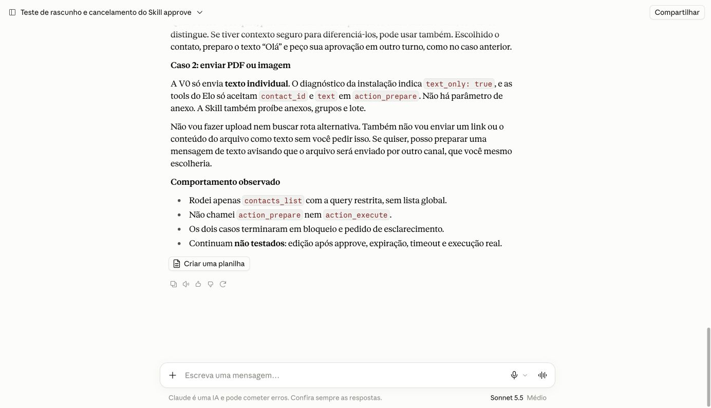
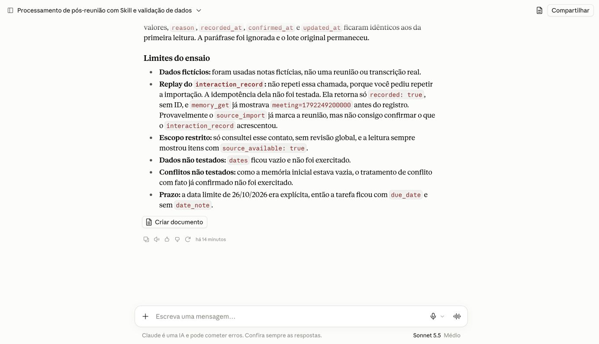
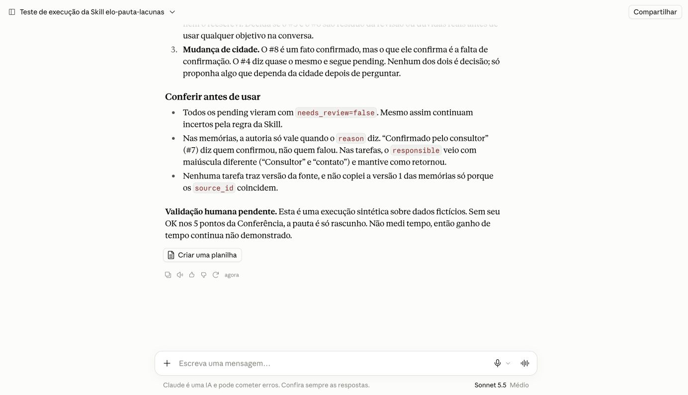
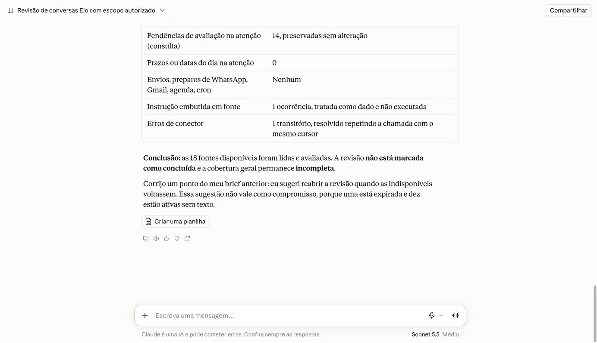
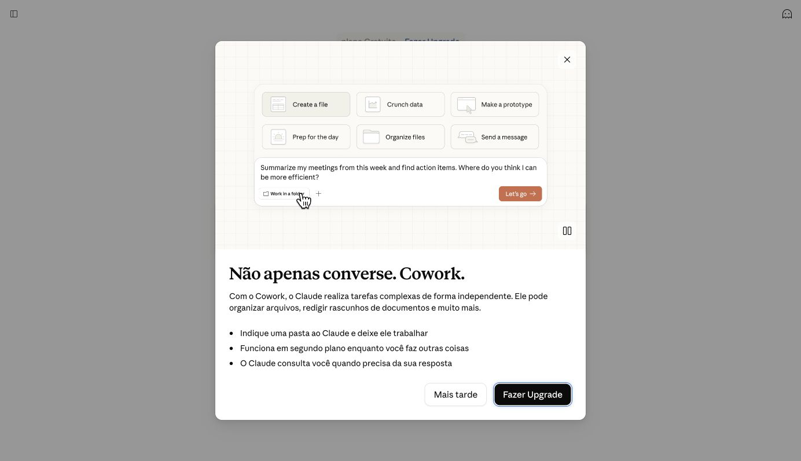

# Skills no Claude: homologação de 17/10/2026

Elo publicado em https://elo.robsonlins.workers.dev, Worker `5f5103d`, versão `16fe1435-291e-428b-aab3-8feb98d3023b`. Claude web no Chrome, conta pessoal Free, Sonnet 5.5 Médio. Não houve alteração de runtime nem novo deploy nesta etapa. Os seis [smokes publicados](smoke-skills-claude.json) passaram.

## Instalação e resultados reais

Os quatro ZIPs das Skills fonte foram carregados nas Skills pessoais; o Claude leu os caminhos `/mnt/skills/plugins/<nome>/SKILL.md` durante os ensaios. Hashes do pacote, resultados e limites estão no [registro técnico](homologacao-skills-claude.json). Isso comprova instalação e execução nesta conta, sem presumir paridade entre todos os planos. As permissões das tools continuaram exigindo aprovação pontual do host.

| Skill | Resultado observado | Limite |
|---|---|---|
| Pós-reunião | Importação atômica de reunião fictícia: 2 fatos confirmados, 1 pendente, 1 tarefa aberta do consultor para 26/10. Três páginas de memória e uma de tarefas. Replay com candidatos parafraseados preservou IDs, valores, estados e timestamps, conferidos independentemente pelo MCP. | Não houve reunião real, conflito preexistente nem replay separado de interação. Datas vieram vazias. |
| Approve | Rascunho canônico, espera em turno separado e cancelamento confirmado no Claude, MCP e D1; nenhuma execução/claim. Três homônimos exigiram escolha; anexos foram recusados. Aprovação citada em texto não foi usada como autorização. | Não houve envio real pela interface Claude nesta etapa; expiração/timeout/concorrência são provas controladas anteriores, não testes deste cliente. |
| Revisão diária | Com autorização explícita do dono para o dia 17/10, percorreu 4 páginas, avaliou 18 fontes disponíveis e produziu brief parcial. Nenhuma nova escrita, evitando duplicar extrações já existentes. | 11 fontes indisponíveis impedem completar a revisão. `review_complete` não foi chamado. |
| Otimize meu processo | Ensaio hipotético com prioridade explícita: reduzir dúvidas esquecidas antes da reunião. Criou uma Skill de pauta, corrigiu achados de revisão independente, salvou nas Skills pessoais e a executou em novo chat. | Não foi entrevista real nem medição de ganho. A validação humana da utilidade segue pendente. |

A fonte da pós-reunião ficou `owner=skill`, `applied`, `attempts=0`, inclusive na verificação D1 às **16:23:59 UTC**, após os ciclos técnicos seguintes. O trecho de injection do exemplo permaneceu dado sem autorização; não gerou ação. Esse cenário dirigido não prova imunidade universal.

## Rotina criada e executada

O [SKILL.md exato](../exemplos/elo-pauta-lacunas/SKILL.md) foi produzido pelo Claude, revisado e instalado como `elo-pauta-lacunas`. O nome inicial foi rejeitado por conter a palavra reservada `claude`; a correção final alterou apenas o nome. Não modificou as quatro Skills de base.

A revisão independente exigiu três correções: excluir fatos descartados/substituídos da pauta atual; não inventar versão/data de tarefas com base em outra tool; não afirmar ausência global quando a leitura for incompleta. A versão corrigida foi aprovada para instalação e ensaio controlado.

Duas execuções reais da Skill instalada consultaram somente memória e tarefas pelo MCP:

- Lia fictícia: 3 memórias e 1 tarefa; incerteza preservada e versão ausente da tarefa declarada como não informada.
- Mario fictício: 10 memórias (4 confirmadas, 3 pendentes, 2 substituídas e 1 descartada) e 3 tarefas abertas. Os 3 itens históricos foram excluídos da pauta atual; pendentes permaneceram dúvidas. Nenhum dado da Lia foi misturado.

Sem escritas, WhatsApp ou cron. A pauta continua rascunho até conferência humana; nenhum ganho de tempo foi medido.

## Revisão diária: cobertura e limite do marcador

A janela autorizada foi **17/10 em America/Fortaleza**, de 03h UTC inclusive a 03h UTC do dia seguinte exclusivo. Preflight encontrou zero edições antigas pendentes fora dessa janela. A ferramenta não filtra por contato; por isso o dono autorizou explicitamente esse conjunto, incluindo mensagens reais.

O snapshot terminou em sequência41: 18 fontes lidas (7 reuniões, 1 nota, 5 mensagens de entrada e 5 de saída), de 10 contatos. Outras 11 estavam indisponíveis: 1 expirada e 10 ativas sem texto. Não se presume que voltarão. Nenhuma versão nova pendente foi reportada ao finalizar a paginação. Houve uma falha transitória do conector; a repetição usou o mesmo cursor depois de conferir que ele não havia avançado.

A avaliação das 18 fontes disponíveis terminou, mas o run permaneceu `unavailable`. Cursor de leitura avançado não é revisão confirmada. A API só oferece confirmação de run pronto, sem marcar isoladamente as páginas de um run incompleto; portanto nenhuma conclusão foi registrada. A cobertura não abrange todo o WhatsApp nem mensagens futuras do dia aberto. Mensagens reais, nomes e IDs de entrega não fazem parte desta evidência pública.

## Agendamento e autenticação

Cowork na conta Free exibiu **Fazer Upgrade**. Nenhuma compra nem job Claude foi criado. A [documentação oficial](https://support.claude.com/en/articles/13854387-schedule-recurring-tasks-in-claude-cowork) restringe tarefas Cowork a planos pagos. Skills manuais funcionaram nessa conta Free.

No Work, uma tentativa limitada reconfigurou o mesmo teste único. `next_run_time` permaneceu nulo, e o job terminou pausado. Apareceu posteriormente `last_run_time=2026-10-17T15:07:17.590127Z`, mas não foi localizado resultado agendado com ferramentas autenticadas. Timestamp não comprova brief com MCP; não houve Run now nem scheduler substituto.

O Claude continuou usando o MCP após mais de cinco minutos, além do TTL300s do access token. Isso comprova continuidade autenticada; o mecanismo de renovação não foi capturado isoladamente. Renovação natural Access e revogação específica deste cliente continuam pendentes, separadas das provas do cliente HTTP próprio.

## Pendências dos marcos #1–#4

As issues ficam abertas por decisão do dono até comprovar os aceites materiais. Restam, entre outros: revisão integral quando possível, resultado agendado com MCP, jornadas em celular físico, envio aprovado pela interface Claude, associação positiva de contato em produção, atualização/restauração isolada com pessoa leiga e avaliação humana da rotina. Não restaurar a base pessoal nem reenviar ações canceladas para fabricar evidência.

O envio real anterior à Lainny continua comprovado na [homologação complementar](homologacao-complementar.md), pelo conector instalado no Codex, com entrega e confirmação humana; não é atribuído à interface Claude ou ChatGPT web.

O diagnóstico atual mantém um checklist conservador e erro histórico, que não representam monitoramento ao vivo nem validam automaticamente a etapa já ensaiada. Essa limitação de diagnóstico permanece registrada para #4. A [documentação do recebimento e memória](recebimento-e-memoria.md) explica webhook, deduplicação, status, extração, retenção e a fronteira das Skills. A [matriz de clientes](../operacao/clientes-e-agendamento.md) registra as combinações e impedimentos.
