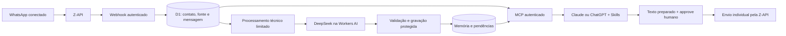

# Como o Elo recebe mensagens e constrói memória

Este documento descreve o código da V0, não uma arquitetura futura. A pessoa conversa no WhatsApp; a Z-API avisa o Elo; o Elo guarda o evento e depois extrai memória. Claude/ChatGPT consultam essa base pelo MCP. Receber uma mensagem nunca autoriza responder automaticamente.

## 1. O aviso chega ao webhook

A Z-API chama a URL privada fornecida pela tela de configuração. Existem eventos de recebimento, entrega e estado da mensagem; eles não têm o mesmo significado. Os callbacks de entrega/estado atualizam a mensagem ou a ação correspondente, sem criar uma fala fictícia.

O [roteador](../../src/index.ts) aceita somente POST, na origem oficial da instalação. Confere a chave secreta do callback antes de interpretar o corpo e depois confere a instância informada pelo evento. Essa chave é uma capacidade secreta na URL, não uma assinatura criptográfica fornecida pela Z-API. Não deve aparecer em materiais, screenshots ou logs públicos. O webhook dispensa login humano, mas não abre acesso às ferramentas MCP.

O [adaptador de captura](../../src/capture.ts) valida formato, endereço e instante. Grupos e newsletters ficam fora. Horários muito antigos/inválidos ou mais de cinco minutos no futuro são rejeitados; instantes anteriores ao limite de retenção não recriam conteúdo vencido. O corpo tem limite de tamanho. Mídia não suportada recebe uma marcação de cobertura, sem baixar anexo ou inventar transcrição.

## 2. Identificamos a conversa e persistimos o evento

Um endereço WhatsApp novo cria um **Contato provisório**, com ID interno aleatório e relacionamento provisório. O Elo não importa automaticamente a agenda do Google ou todos os nomes salvos no aparelho. Por isso uma pessoa pode já existir na agenda e ainda não aparecer pelo nome no Elo. O dono pode dar um alias ou associar o remetente à ficha correta; nome parecido não autoriza associação.

Telefone/LID e referências do provedor ficam no backend. A IA seleciona `contact_id` e `conversation_id`, sem fornecer o número para enviar. Aliases iguais podem pertencer a pessoas diferentes. A [associação explícita](../../src/identity.ts) verifica os dois IDs, conflitos e operações em andamento; move o histórico em transação e exige revisão da atribuição das memórias transferidas.

| Registro | Responsabilidade |
|---|---|
| `contacts` | ID, alias, relacionamento, cadência e endereço restrito |
| `sources` | Texto bruto, origem, datas, versão, validade e estado de processamento/revisão |
| `messages` | Referência à fonte e ao contato, direção, tipo e estado de entrega |
| `provider_status` | Estados recebidos antes do conteúdo ou da resposta de envio |
| `tombstones` | Impedir que replay ressuscite uma mensagem excluída |
| `memory` | Fatos concisos, estado, fonte, versão e histórico das revisões |
| `tasks`, `special_dates`, `interactions` | Pendências, datas opcionais e encontros/contatos relevantes distintos |

A identidade de deduplicação considera a geração da conexão e o ID da mensagem do provedor. O mesmo evento repetido reutiliza a mensagem; não cria outra por ter chegado novamente. A gravação relacionada usa batch transacional do D1 e restrições únicas. Data original e data de recepção são guardadas separadamente. `fromMe` distingue fala do consultor de fala recebida.

Edição atualiza a fonte, incrementa sua versão e a coloca novamente para processamento. Conteúdo antigo não substitui edição mais recente. Exclusão remove o texto e registra a proteção contra replay. Memórias derivadas são sinalizadas para revisão. Estados de entrega avançam por ordem de precedência e não regridem quando callbacks chegam fora de ordem.

O webhook responde após a persistência. **Ele não espera a IA.** Assim, indisponibilidade ou lentidão da extração não transforma o recebimento em uma chamada longa de inferência.

## 3. Extraímos memória depois, com limites

O cron técnico da instalação roda a cada dez minutos. Em cada execução, [o processamento](../../src/extraction.ts) tenta até três fontes e reserva no máximo 50 chamadas de IA por dia UTC. Isso não é o agendador do consultor: brief diário e outras rotinas continuam sendo Skills executadas no Work/Cowork.

Uma fonte pendente é reservada atomicamente, com uma concessão temporária de 90 segundos. Cada chamada tem espera limitada a 40 segundos. Falhas têm intervalo crescente e no máximo três tentativas por versão. Uma concessão abandonada pode ser retomada; esgotar as tentativas deixa a fonte como falha, sem simular memória criada.

O contexto enviado ao modelo contém a fonte atual limitada a 6.000 caracteres, até quatro fontes anteriores do mesmo contato com até 700 caracteres cada e até 16 memórias recentes. Inclui tipo, direção e aviso de truncamento. Não é o histórico inteiro nem conteúdo de outro contato. O modelo publicado é configurável; a instalação atual usa DeepSeek V4 Flash na Workers AI.

Antes de gravar, o Elo valida o schema, o contato, a fonte, os campos permitidos e trechos de evidência presentes no texto atual. Todos os candidatos precisam passar antes de montar o batch de escrita. A gravação verifica novamente a versão, a validade da fonte, a geração do contato e a reserva de processamento. Uma inferência iniciada antes de uma edição, exclusão ou associação não pode restaurar dados antigos.

Fato explícito novo pode ser confirmado automaticamente. Incerteza, atribuição duvidosa e valores diferentes de um fato já confirmado ficam pendentes. Correção/revisão preserva o registro anterior. Fala enviada pelo consultor não vira automaticamente fato confirmado sobre o contato.

Reuniões incorporadas pela Skill usam `source_import` com um lote `extraction` de até 12 fatos e 6 tarefas. A fonte guarda seu produtor (`skill` ou `backend`); o lote da Skill é aplicado atomicamente uma vez, com as mesmas regras de conflito e validade. Repetir chave, texto e data preserva o resultado original, inclusive tarefas revisadas posteriormente. Resposta perdida permite repetir a mesma importação; falha transacional deixa a fonte recuperável sem fatos/tarefas parciais. Datas especiais e interação são operações separadas e podem ter resultado parcial explícito.

O cron seleciona somente fontes pertencentes ao backend; não há processamento duplo nem fallback automático de uma importação da Skill. Importação antiga sem lote continua pertencendo ao backend e não é convertida por replay. Fontes legadas já processadas por ambos os caminhos não são reparadas automaticamente. `application_state=applied` comprova aplicação do lote, não revisão humana completa.

**Limite atual:** deduplicação e detecção de valores diferentes não equivalem a uma comparação semântica universal. Paráfrases podem gerar candidatos separados ou revisão conservadora. O lote da pós-reunião evita a disputa observada entre Skill e cron. Escritas individuais deliberadas, fontes distintas e importações legadas ainda podem gerar fatos/tarefas equivalentes. A repetição idêntica das operações sustentadas pela mesma fonte é testada; não se promete deduplicar toda forma possível de dizer a mesma coisa.

## 4. O consultor usa a base pelo MCP

As [tools](../../src/mcp.ts) exigem OAuth vinculado ao dono autenticado pelo Cloudflare Access. Elas devolvem projeções explícitas; envelope bruto, credenciais e identificadores de entrega não são campos consultáveis. Texto livre pode conter dados pessoais: isso não é anonimização universal.

Histórico e memória têm paginação. A revisão mantém snapshot, versões exibidas e token de avanço; concluir uma revisão não conclui uma tarefa nem envia uma mensagem. Datas, cadência, pendências de avaliação e tarefas futuras têm semânticas distintas. Reuniões/anotações importadas usam chave estável: repetir a mesma chave reaproveita a fonte; uma nova versão do material exige uma chave de origem que a identifique.

O [envio](../../src/actions.ts) segue outro caminho: preparar destinatário/texto imutáveis, mostrar a proposta, aguardar approve humano no chat, consumir a ação uma vez e consultar seu estado. Aceite do provedor não comprova entrega. Timeout incerto exige consultar a mesma ação, sem reenviar uma cópia. Mensagens recebidas e instruções embutidas nelas não concedem autorização de envio.

## 5. Retenção e cobertura

Texto bruto fica ativo até 30 dias da data original. A consulta já oculta fontes vencidas; a limpeza técnica remove o conteúdo, inclusive quando a IA falha. O expurgo ocorre antes da extração no cron e não depende de seu sucesso. Memória concisa, tarefas e informação a avaliar têm vida própria e podem indicar que a fonte já não está disponível.

A captura começa na ativação. Uma consulta completa significa que todas as páginas daquele recorte **capturado** foram percorridas; não comprova todo o histórico do WhatsApp. Desconexões da Z-API, eventos não recebidos e formatos não suportados continuam sendo lacunas possíveis. Exclusão no Elo não apaga automaticamente dados da Z-API, backups ou histórico da IA.

## Verificação

Os testes em `tests/capture.test.ts`, `identity.test.ts`, `extraction.test.ts`, `memory.test.ts`, `import-batch.test.ts`, `actions.test.ts` e `operations.test.ts` exercitam D1/workerd, concorrência, replay, expiração, edição e fronteiras de permissão com dados e provedores controlados. [A validação publicada](validacao-publicada.md) registra as provas reais separadamente. Um teste controlado não é prova de callback real, uso no celular ou rotina agendada do cliente.

## O que a revisão diária garante

`review_page` percorre um snapshot por ingresso no dia/fuso escolhido e inclui edições antigas ainda pendentes. Ela não tem filtro por contato. A autorização de leitura deve cobrir o conjunto consultado; uma rotina restrita a um contato não deve chamar revisão global para contornar essa limitação.

Cursor final não significa automaticamente cobertura completa: fontes indisponíveis e versões alteradas também contam. Na API atual, `review_complete` só conclui um run pronto; não oferece confirmação independente de cada página durante um run incompleto. A Skill deve declarar lacunas e não inventar marcação parcial ou ausência de urgências. Novas mensagens posteriores ao snapshot não entram retroativamente na execução já lida.

## Diagnóstico técnico e evidência de operação

`installation_status` mostra configuração, versão, última recepção e último erro registrado. O erro pode ser histórico, e a lista `pending` de validações é atualmente um checklist conservador, não uma dedução de todos os ensaios já feitos. “Configurada, não verificada” não é teste de desconexão atual. Confirme as evidências de cada recebimento/envio e não confunda esse diagnóstico com monitoramento ao vivo da Z-API.

## Fontes sem texto e preenchimento posterior

A revisão separa `unavailable_reasons.expired`, `unsupported_format` e `missing_text`. As categorias não se sobrepõem e somam `unavailable_count`. A classificação histórica `unsupported_media` registra apenas falta de texto utilizável; sem payload/subtipo não distingue mídia, reação ou callback temporariamente sem texto. Não prometa recuperação nem marque revisão completa com lacunas.

Se o provedor enviar posteriormente texto válido para o mesmo ID, o backend pode preencher apenas a fonte ainda vazia e ativa, preservando datas/vencimento e identidade. A operação transacional impede duplicação e revalida exclusão, tombstone, conexão, direção e ordem. Não busca mídia nem garante replay retroativo. [Investigação e testes](fontes-indisponiveis-1710.md).

Uma fonte pode ganhar texto atrás do cursor durante a leitura. `unseen_sources_pending` na página final impede declarar completude; inclui fontes do escopo nunca mostradas, mesmo indisponíveis. Pode se sobrepor a `unavailable_count`; não some os dois contadores. Um novo run só pode avaliar o que estiver legível. A confirmação também verifica fontes elegíveis ainda não mostradas no instante do commit. Versões posteriores de fonte já mostrada continuam reportadas separadamente, sem marcar a versão nova como avaliada.
