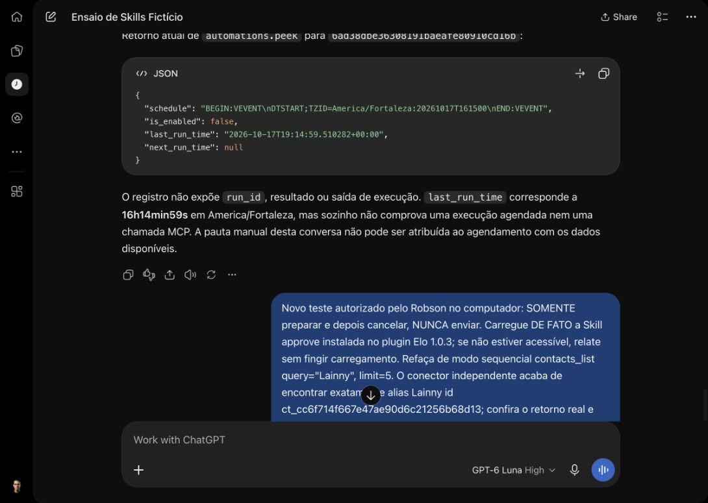
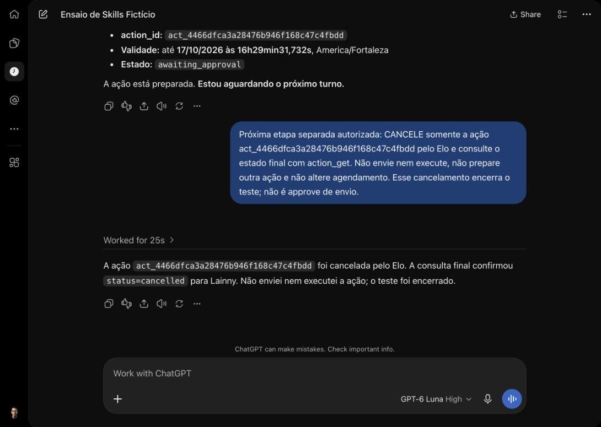

# Execução única pela interface e rascunhos — 17/10/2026

Esta rodada é posterior ao PR #17: aquele relatório descreve corretamente o estado pausado anterior. Não houve alteração de código ou deploy.

## Agendamento pela interface

No mesmo registro Work `6ad38dbe36308191baeafe80910cd16b`, o editor nativo foi configurado com **Repeat task desligado**, data 17/10 e horário **16h15 GMT-3**, sem mudar as instruções de leitura do contato fictício. Save confirmou “Today 4:15 PM”; Resume habilitou. Não houve Run now nem nova tarefa/recorrência.

O cliente relatou `automations.peek` antes do horário: `DTSTART;TZID=America/Fortaleza:20261017T161500`, sem RRULE, `is_enabled=true`, próxima e última execução nulas. Depois do horário, nova consulta somente de metadados relatou **is_enabled=false**, **last_run_time=2026-10-17T19:14:59.510282Z** e **next_run_time=null**. Portanto, o estado do agendador mudou para terminal sem reativação ou execução manual pelo agente.

Na mesma conversa sincronizaram mensagens manuais do iPhone e apareceu uma resposta combinando cancelamento e pauta do contato fictício. Não foi exposto run_id ou resultado isolado da execução; a própria resposta chamou a leitura de manual. **Não atribuir essa pauta ao agendamento nem declarar o ciclo Skill/MCP agendado integralmente comprovado.** O registro de última execução e seu encerramento foram observados; a origem isolada do resultado continua pendente. Não fazer novas tentativas indefinidas nem criar scheduler no Elo.

## Relato do iPhone e conferência

O dono relatou “aparentemente deu certo” para preparo/espera/cancelamento. A conferência D1 somente leitura às 19h14 UTC não encontrou nenhuma ação preparada desde 19h UTC; a conversa sincronizada mostrou que a busca por Lainny falhou antes do preparo. Assim, não havia rascunho para cancelar e esse relato não homologa preparo/cancelamento no aparelho. O dono pediu continuar os testes no computador, sem novas solicitações desse ensaio no celular.

Uma consulta independente `contacts_list(query=Lainny, limit=5)` encontrou exatamente o contato esperado. A causa da falha transitória no outro cliente não foi determinada; não concluir que Lainny estava ausente da base.

## Preparo e cancelamento no computador

No ChatGPT Work web / GPT-6 Luna High, o cliente relatou carregar approve do plugin Elo 1.0.3, confirmou contato e preparou o texto sintético “Teste de preparo e cancelamento do Elo. Não enviar.”. Cancelou a mesma ação no mesmo turno, embora o pedido pedisse espera. `action_get` independente confirmou texto/destinatário e estado **cancelled**; D1 confirmou `claimed_at=null`, texto exato e **zero eventos executing**. Não houve envio.

Essa rodada comprova preparo/cancelamento, mas **não comprova espera em turno separado**, approve humano ou envio pela interface. O cancelamento no mesmo turno é um desvio do roteiro, preservado nesta evidência; não foi tratado como execução indevida de WhatsApp. Uma etapa isolada de espera foi iniciada separadamente.

## Espera isolada e encerramento

Um segundo pedido restringiu o turno **somente** a preparar “Teste de espera do Elo. Não enviar.”, proibindo também cancelar naquele turno. O cliente encerrou mostrando proposta e estado **awaiting_approval**. `action_get` independente confirmou esse estado antes da próxima mensagem. Só então foi enviado outro pedido de cancelamento, sem approve ou execução; a resposta final e a D1 confirmaram **cancelled**. Os dois rascunhos do computador terminaram cancelados, com `claimed_at=null` e zero eventos `executing`, conferidos às **19h20 UTC**.

Isso exercita preparação, espera e cancelamento em turnos distintos no computador; os pedidos de teste foram conduzidos pelo agente com autorização do dono. **Não é uma prova independente de gesto humano de approve, de envio web ou de preparo/cancelamento no iPhone.** O desvio do primeiro ensaio não foi apagado pelo segundo resultado. [Resumo estruturado](work-ensaio-unico-interface-1710.json).
