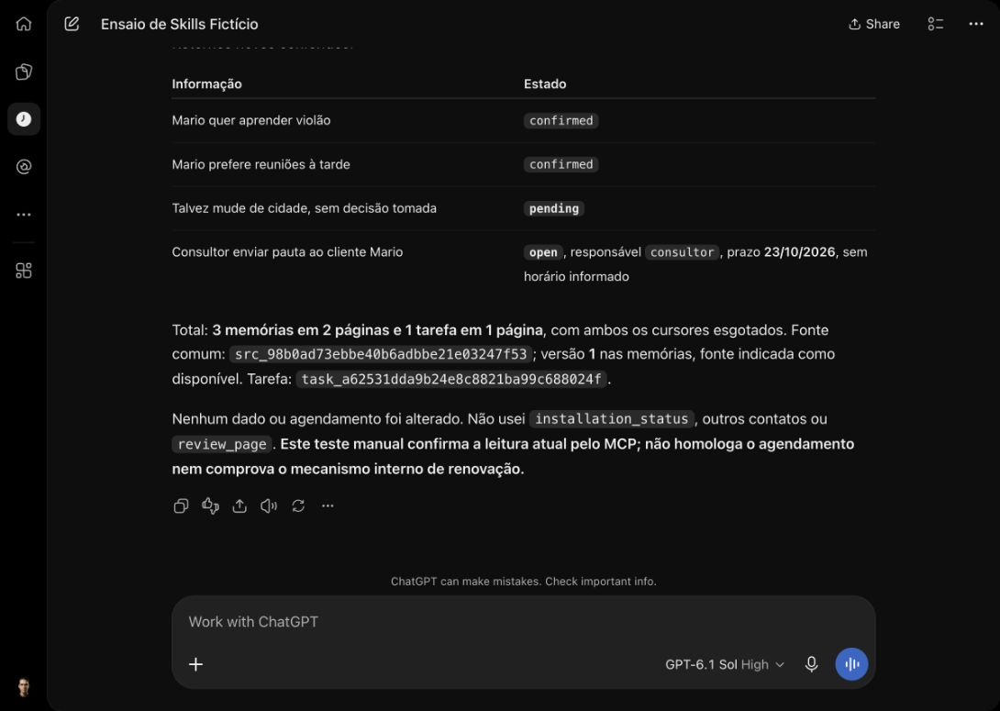

# Retomada do Work — 17/10/2026

A confirmação do dono no navegador interno terminou em erro de rota OpenAI, sem sessão. A sessão já existente no perfil Robson do Chrome permitiu continuar. Não foi alterada a autenticação do Elo.

## Leitura manual atual

No ChatGPT Work web, **GPT-6.1 Sol High**, foi enviado um novo pedido limitado à consulta da tarefa agendada e à leitura do contato fictício SIM-ELO-1710 Mario. A resposta terminou às **16h01min49s, America/Fortaleza**. Houve erro transitório de carregamento; uma recarga recuperou a mesma resposta, sem segundo pedido.

A interface exibiu **Used Automations and Elo**. A resposta informou `memory_get` em duas páginas (2 + 1 itens) e `tasks_get` em uma página (1 item), cursores nulos: dois fatos confirmados, mudança de cidade pendente e tarefa aberta do consultor até 23/10/2026, sem hora inventada. Os payloads individuais das chamadas não ficaram visíveis no painel inspecionado; a paginação é relatada pelo cliente, não uma captura independente de cada chamada.

Uma consulta independente pelo conector Elo confirmou os três registros de memória e a tarefa, estados, responsável, prazo e cursores nulos. Isso confere os dados retornados, sem provar por si só quais chamadas o navegador realizou. Não houve pedido de escrita, leitura de outros contatos ou WhatsApp. [Registro estruturado](work-retomada-1710.json).

## Agendamento permanece pendente

A busca em Scheduled encontrou **Elo homologação agendada**, pausada. Abrir a tarefa levou à conversa de origem; o editor foi apenas inspecionado e fechado sem salvar. O retorno de `automations.peek` relatado pelo cliente manteve `is_enabled=false`, `next_run_time=null` e `last_run_time=2026-10-17T15:07:17.590127Z`. A interface e as ferramentas disponíveis não forneceram resultado/log detalhado dessa execução. O timestamp sozinho não comprova MCP nem brief agendado.

Nenhuma tarefa foi reativada, editada ou executada por Run now. Esta leitura manual **não homologa agendamento, renovação/revogação específica do Access, envio pela interface web nem revisão diária integral**. Issues #1–#4 continuam abertas.

## Claude e saúde publicada

No Claude web/Sonnet 5.5 Médio, foi autorizada uma única `review_page` para o mesmo dia, `limit=1`, sem completar ou continuar a revisão. O cliente retornou snapshot **53**, uma fonte nesta página e cursor seguinte presente: **14 indisponíveis = 1 expired + 13 unsupported_format + 0 missing_text**. Cobertura `complete`, `available_complete` e `current_versions_complete` falsas; versões novas pendentes e fontes não mostradas pendentes iguais a zero; completude externa desconhecida.

O primeiro resumo do Claude sugeriu incorretamente que `unsupported_format` contradizia a descrição anterior “ativas sem texto”. Foi solicitada correção sem novas ferramentas: a categoria significa ausência de representação textual utilizável; `missing_text` é outra categoria operacional. Não deduzir mídia exata ou recuperação. Os snapshots anteriores 41/49 e o atual 53 são conjuntos diferentes.

Uma chamada independente ao Elo retornou o mesmo snapshot e contagens, com projeção local somente de cobertura e presença de cursor; não foram publicados texto, IDs ou tokens dessa página. [Registro sanitizado](claude-cobertura-retomada-1710.json). Isso não constitui revisão diária integral nem marcação de conclusão. `review_page` cria o estado técnico de paginação; não houve alteração de memória/tarefa/cadência ou envio.

O comando `node scripts/smoke.mjs` passou novamente seus seis checks na URL pessoal, confirmando D1 saudável e a mesma versão **fa8c0a95 / código 4a3945b**. O erro de login OpenAI não foi usado como prova de falha no Elo. [Smoke publicado](smoke-retomada-1710.json). Não houve mudança de runtime ou deploy nesta retomada.
