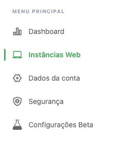
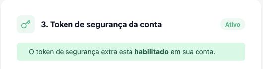
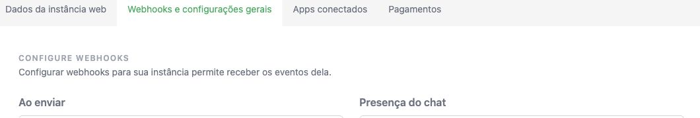

# Conectar o WhatsApp sem adivinhar os campos

A IA conduz esta etapa. Você só entra no painel, preenche credenciais na tela protegida do Elo e faz o pareamento. Sem instância Z-API, pode continuar usando a memória e conectar o WhatsApp depois. Não contrate ou ative cobrança sem conferir o valor.

As imagens são **recortes do painel Z-API logado, consultado no Chrome em 22/10/2026**. Não são telas simuladas. Foram capturadas sem os valores dos campos, nomes da instância, telefones ou endereços privados; o layout pode mudar. [Origem e limites das capturas](imagens/zapi/README.md).

## 1. Encontre cada dado no lugar certo

No [painel Z-API](https://app.z-api.io/), use o menu lateral:

| Campo na tela do Elo | Onde encontrar na Z-API | Cuidado |
|---|---|---|
| ID da instância | **Instâncias Web → sua instância → Dados da instância web → Credenciais** | Escolha a instância do número que deseja conectar. |
| Token da instância | Na mesma área de **Credenciais**, em **Token da instância**. A página também usa o rótulo **Token de integração**. | Use o token existente; **Gerar novo token** altera uma credencial em uso. |
| Client-Token da conta | **Segurança → Token de segurança da conta**. É outra página. | Protege a conta Z-API, podendo afetar outras instâncias. Não é o token da instância. |

Se o token da conta ainda não existe, a documentação oficial orienta **Configurar agora**. Ele nasce desabilitado; a ativação passa a exigir o token nas chamadas de **todas as instâncias da conta**. A IA deve conferir integrações existentes e explicar o impacto antes de você autorizar criação/ativação. Não gere nem rotacione tokens só para seguir um tutorial.

Preencha os três dados **diretamente em `/setup` da sua instalação Elo**, após login Access. Não os envie pelo chat ou suporte. Clique **Salvar e verificar conexão**. O Elo consulta a conexão naquele instante e mantém novos envios pausados. Se desconectado, faça o pareamento no painel Z-API e salve de novo para validar o aparelho.

**Salvar novamente muda o endereço de recebimento e impede executar aprovações antigas.** Atualize os endereços na Z-API e prepare novamente mensagens pendentes. Não é preciso salvar de novo a cada uso.

## 2. Configure os avisos de novas mensagens

**Webhook** ou **callback** é o aviso que a Z-API manda ao Elo quando recebe uma mensagem ou muda o estado de um envio. Você não precisa escrever código: a tela Elo fornece o endereço privado que será colocado no painel Z-API.

Antes de ativar, confirme que autoriza a captura: novas conversas individuais podem começar a ser armazenadas no Elo. Histórico bruto ativo dura até 30 dias; memória concisa e pendências têm vida distinta. Mensagens podem conter dados pessoais.

Abra **Instâncias Web → sua instância → Webhooks e configurações gerais**:

Na tela Elo, encontre o endereço privado em **Configure o recebimento**. A IA transfere esse endereço por ferramenta protegida, se disponível; caso contrário, copie diretamente entre os dois painéis, sem passar pelo chat.

| Campo real na Z-API | O que preencher/selecionar | Para quê |
|---|---|---|
| **Ao receber** | Endereço privado do Elo | Receber novas mensagens. |
| **Notificar as enviadas por mim também** | Ativar, com captura autorizada | Incluir mensagens que você envia pelo próprio WhatsApp. |
| **Ao enviar** | O mesmo endereço privado | Receber avisos de envio do provedor. |
| **Receber status da mensagem** | O mesmo endereço privado | Acompanhar mudança de estado dos envios. |
| **Ignorar webhook de recebimento/envio/status** | Deixar desativado para os eventos usados | Esses controles impedem o aviso correspondente. |

Confira também **Configurações ao receber**: não ignorar chats privados ou mensagens de texto, pois isso impede sua captura. Grupos não são suportados no Elo V0. Não mude filtros de uma instância compartilhada com outro sistema sem analisar o efeito nele. Clique **Salvar** somente depois de conferir o destino e autorizar a captura.

Este guia não usa o MCP da Z-API: o conector da pessoa é o **MCP do Elo**, com a URL da própria instalação. Não adicionar outra integração por engano.

## 3. Confira com um exemplo controlado

1. Combine com um contato de teste uma mensagem fictícia e autorize esse teste.
2. No Claude/ChatGPT com Elo conectado, peça: “Confira se o Elo recebeu a mensagem de teste e consulte o conteúdo disponível”. A IA verifica a persistência; só ver texto no WhatsApp não comprova captura no Elo.
3. Se quiser testar envio, escolha **Habilitar envios aprovados** no Elo, peça o envio para pessoa inequívoca e assunto no chat; a IA redige e envia direto. Se quiser revisar, peça prévia e aprove uma vez. Consulte o resultado da mesma ação. Aceito não é entregue; resultado incerto não deve ser repetido.

**Habilitar envios não ativa recebimento. Pausar envios não pausa captura.** A opção Revogar conexão no Elo remove a conexão usada por ele; pareamento e dados na Z-API são administrados no provedor. Não precisa habilitar envios para apenas consultar memória.

Credenciais salvas, conexão observada no salvamento, callbacks preenchidos e primeiro evento persistido são verificações diferentes. Evento antigo não comprova saúde atual ou histórico completo. O Elo não importa automaticamente todas as conversas anteriores, não analisa mídia recebida e só envia texto individual.

Depois, peça **“Use configurar-elo e me mostre como usar o Elo”**. Mapear a agenda é opcional e pede autorização própria para guardar contatos.

## Se travar

- **Não achei o Client-Token:** ele fica em Segurança da conta, fora da instância. A IA deve mostrar esse caminho antes de sugerir gerar outro token.
- **Credencial recusada:** conferir os três campos nos painéis protegidos, sem mostrá-los no chat; não trocar todos os tokens automaticamente.
- **Não chega mensagem:** conferir os campos acima, filtros e controles de ignorar, configuração atual e diagnóstico. Não reenviar mensagens reais em sequência para adivinhar a causa.
- **Não sei o próximo passo:** peça à IA “não achei este campo; me guie um passo por vez”.
- **Segredo exposto:** interrompa o compartilhamento e trate a rotação com a IA/dono considerando as integrações da conta. Não publique o valor exposto nem o endereço do webhook.

Referências oficiais consultadas em 22/10/2026: [ID e Token](https://developer.z-api.io/security/introduction), [Token de segurança da conta](https://developer.z-api.io/security/client-token). Os rótulos de webhooks acima foram conferidos diretamente no painel autenticado; não houve alteração de configuração durante a documentação.
